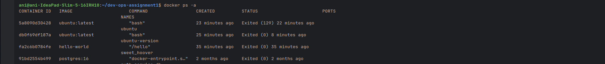
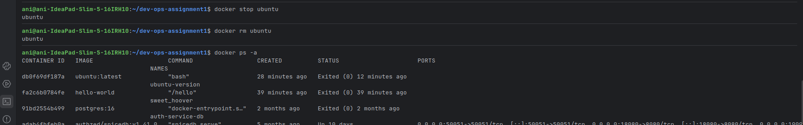

# dev-ops-assignment1

## Part 1
1. Run "Hello World" container and observe the results:
   * To run this container we need to execute this command:
   > docker run hello-world
   
   * Docker run will create and run the "hello-world" image container, which will be pulled from docker hub, The output shows us the hello world output and confirms that docker is working properly, we also see the step-by-step explanation of what docker is doing under the hood

2. Run interactive ubuntu container
   * The command we need to execute, we can say which version of ubuntu image we want, now I will not specify and just say latest, overall better to specify if your environment expects a certain version of an official image
   > docker run -it --name ubuntu-version ubuntu:latest bash
   
   * As we can see docker pulled the specified image, as it was not found  and ran the container in interactive mode with a terminal

3. Install curl inside the container and check internet connection
   * We are inside the ubuntu container and we will execute these commands to update the package list, install curl and check connection:
   * > apt update
     > apt install -y curl
     > curl -I https://github.com
   
   

4. Exit the container
   * To exit the container we need a simple exit command
   > exit
   

5. Show a list of all the containers, stop and delete one of them
   * For showing a list of all containers docker has this command, with -a flag we will also show the stopped containers not just the running ones
   > docker ps -a
   
   * To stop and than delete a container we run
   > docker stop ubuntu
   > docker rm ubuntu
   
   As we can see after stopping and than removing the container we no longer see it in the list of containers

## Part 2 - creating our own python application image

1. Create a folder for your project
2. Create a simple python script
3. Create a Dockerfile
4. Build your docker image from new dockerfile
5. Run this container
6. Assign a tag to this image and display all image list

## Part 3 - using docker volumes for saving data

1. Create a named docker volume
2. Run container with mounted volume
3. Create and save a file inside a container
4. Run another container with the same volume and check the file
