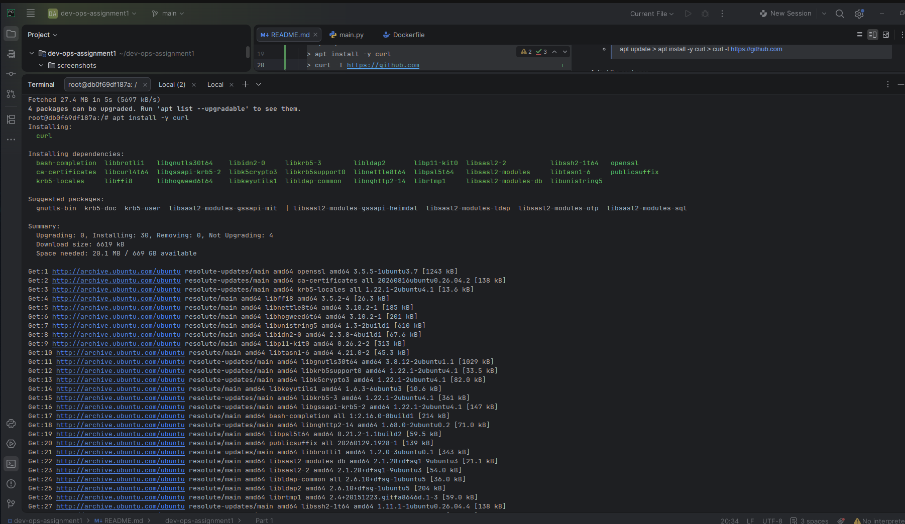
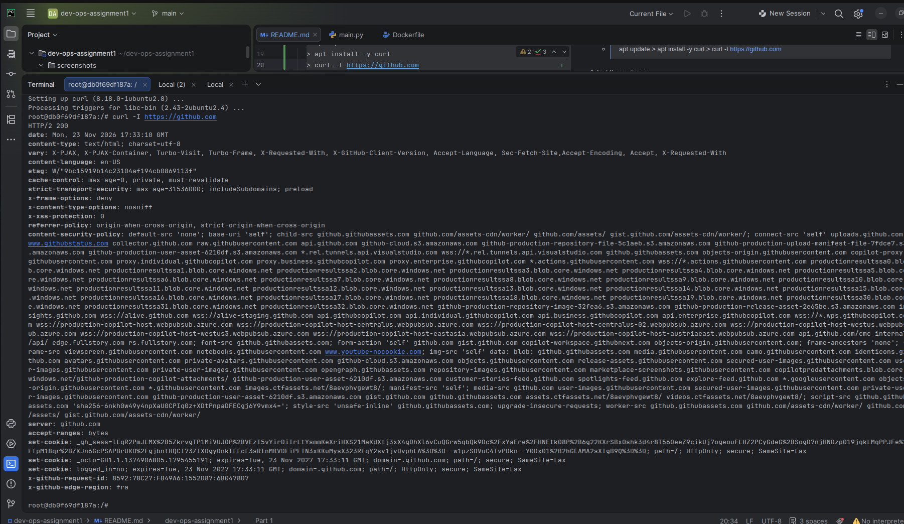
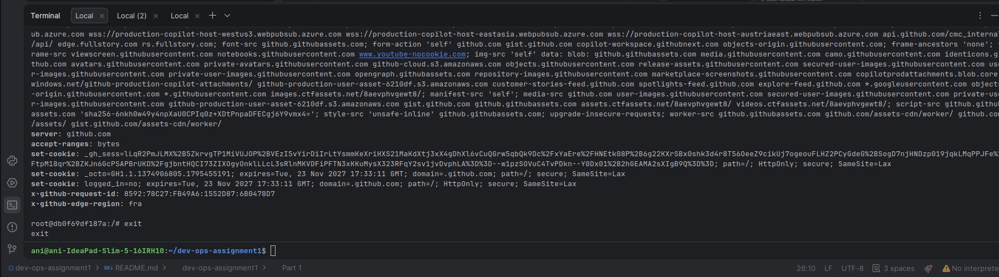

# dev-ops-assignment1

## Part 1
1. Run "Hello World" container and observe the results:
   * To run this container we need to execute this command:
   > docker run hello-world
   
   * Docker run will create and run the "hello-world" image container, which will be pulled from docker hub, The output shows us the hello world output and confirms that docker is working properly, we also see the step-by-step explanation of what docker is doing under the hood

2. Run interactive ubuntu container
   * The command we need to execute, we can say which version of ubuntu image we want, now I will not specify and just say latest, overall better to specify if your environment expects a certain version of an official image
   > docker run -it --name ubuntu-version ubuntu:latest bash
   
   * As we can see docker pulled the specified image, as it was not found  and ran the container in interactive mode with a terminal

3. Install curl inside the container and check internet connection
   * We are inside the ubuntu container and we will execute these commands to update the package list, install curl and check connection:
   * > apt update
     > apt install -y curl
     > curl -I https://github.com
   
   

4. Exit the container
   * To exit the container we need a simple exit command
   > exit
   

5. Show a list of all the containers, stop and delete one of them
   * For showing a list of all containers docker has this command, with -a flag we will also show the stopped containers not just the running ones
   > docker ps -a
   
   * To stop and than delete a container we run
   > docker stop ubuntu
   > docker rm ubuntu
   
   As we can see after stopping and than removing the container we no longer see it in the list of containers
6. 
ნაწილი 2: საკუთარი Python აპლიკაციის იმიჯის შექმნა (Build)
1. შექმენით სამუშაო საქაღალდე (Folder) თქვენი პროექტისთვის.
2. შექმენით მარტივი Python სკრიპტი.
3. შექმენით Dockerfile.
4. ააწყვეთ (Build) Docker იმიჯი.
5. გაუშვით კონტეინერი შექმნილი იმიჯიდან.
6. მიანიჭეთ იმიჯს თეგი (Tag) და გამოიტანეთ ყველა იმიჯის სია.

ნაწილი 3: Docker Volume-ების გამოყენება მონაცემების შესანახად
1. შექმენით სახელდებული (Named) Docker Volume.
2. გაუშვით კონტეინერი მიბმული (Mounted) Volume-ით.
3. კონტეინერის შიგნით შექმენით და შეინახეთ რაიმე ფაილი.
4. გაუშვით სხვა კონტეინერი იმავე Volume-ის გამოყენებით და დაადასტურეთ, რომ ფაილი შენახულია.