# dev-ops-assignment1

## Part 1
1. Run "Hello World" container and observe the results:
   * To run this container we need to execute this command:
   > docker run hello-world
   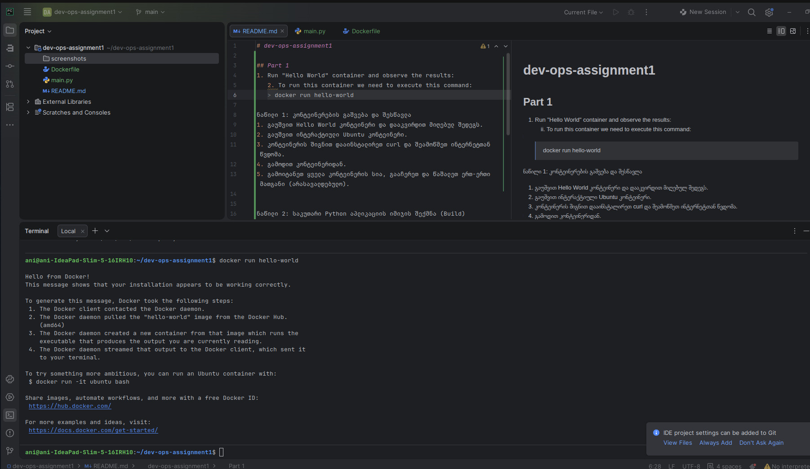
   * Docker run will create and run the "hello-world" image container, which will be pulled from docker hub, The output shows us the hello world output and confirms that docker is working properly, we also see the step-by-step explanation of what docker is doing under the hood

2. Run interactive ubuntu container
   * The command we need to execute, we can say which version of ubuntu image we want, now I will not specify and just say latest, overall better to specify if your environment expects a certain version of an official image
   > docker run -it --name ubuntu-version ubuntu:latest bash
   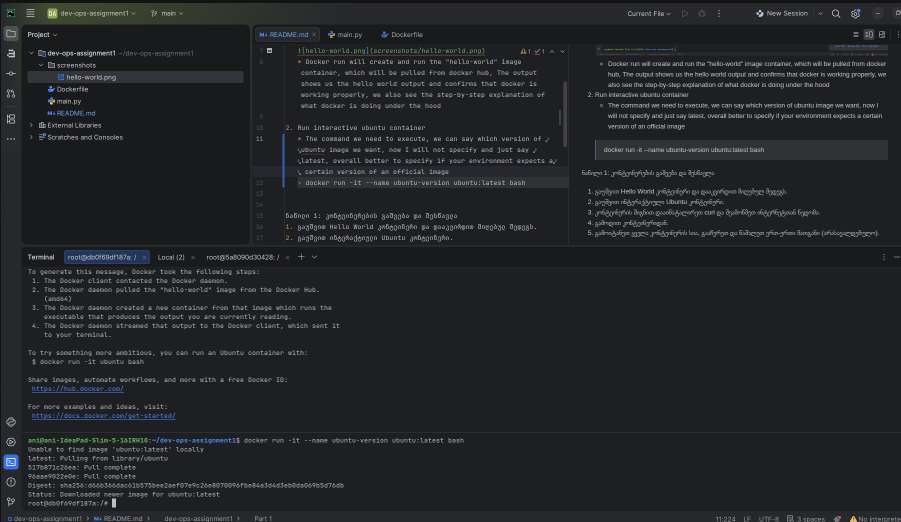
   * As we can see docker pulled the specified image, as it was not found  and ran the container in interactive mode with a terminal

3. Install curl inside the container and check internet connection
   * We are inside the ubuntu container and we will execute these commands to update the package list, install curl and check connection:
   * > apt update
     > apt install -y curl
     > curl -I https://github.com
   
   

4. Exit the container
   * To exit the container we need a simple exit command
   > exit
   

5. Show a list of all the containers, stop and delete one of them
   * For showing a list of all containers docker has this command, with -a flag we will also show the stopped containers not just the running ones
   > docker ps -a
   
   * To stop and than delete a container we run
   > docker stop ubuntu
   > docker rm ubuntu
   
   As we can see after stopping and than removing the container we no longer see it in the list of containers

## Part 2 - creating our own python application image

1. Create a folder for your project
   * To create a new folder named "app" we run this command
   > mkdir -p ~/dev-ops-assignment1/app
   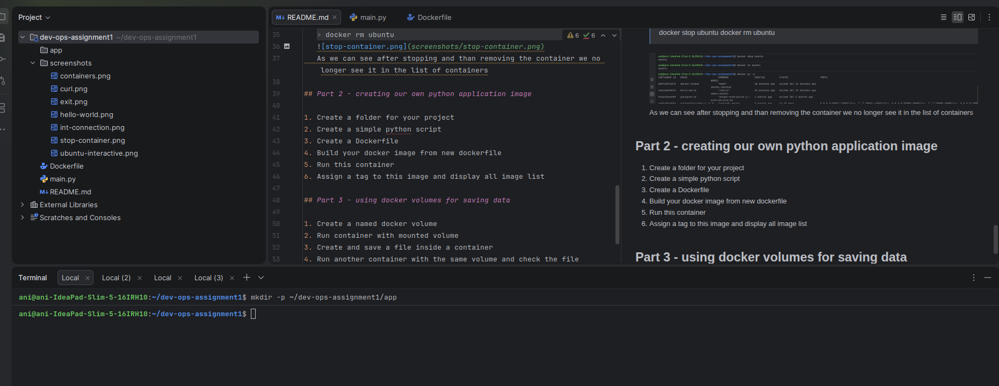
2. Create a simple python script
   * We create main/py inside app either manually or with command:
   > nano main.py
   * I created fibonacci function in main.py and called it for 10 and this is the output:
   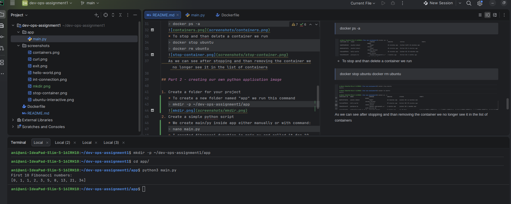
3. Create a Dockerfile
   * We create a Dockerfile, manually or with nano Dockerfile
   * Now we write the content, we configure which base image we use for python, we set a working directory inside a container and copy main.py and state commands for start up, for now that would be sufficient, because our app is not complicated
4. Build your docker image from new dockerfile
   * Now in the same directory where our Dockerfile is we execute this command to build the image
   > docker build -t fibonacci-app .
   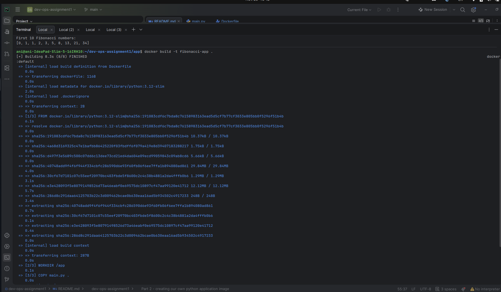
5. Run this container
   To run this container we just tell Docker which image to run
   > docker run --name fibonacci-container fibonacci-app
   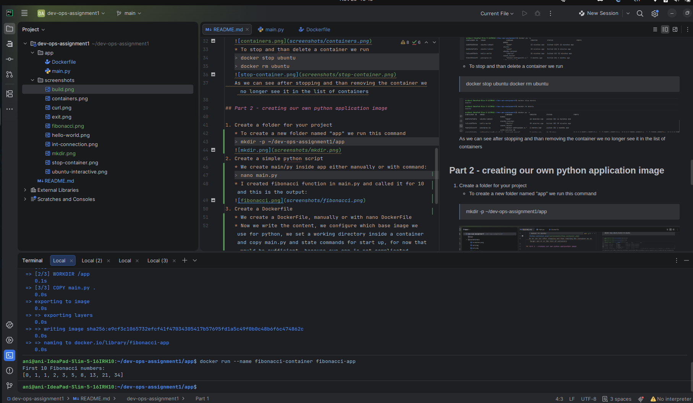
   and we see a successful results
6. Assign a tag to this image and display all image list
   * Now we tag our image, we can tag it with the verion and we execute this command and than docker images to display all locally available images and we see out new tagged image:
   > docker tag fibonacci-app fibonacci-app:v1
   > docker images
   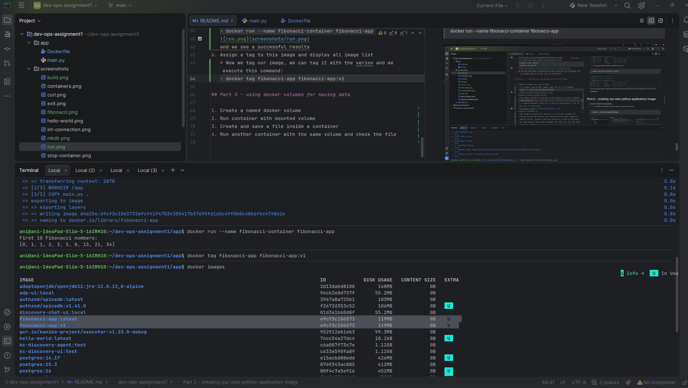
## Part 3 - using docker volumes for saving data

1. Create a named docker volume
   * We move to volumes and to create a named volume we neeed to use this docker command and choose a name "fibonacci-volume" and to check ti actully exists we run second command
   > docker volume create fibonacci-volume
   > docker volume ls
   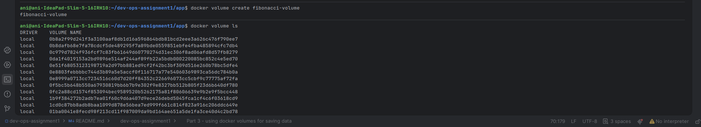
   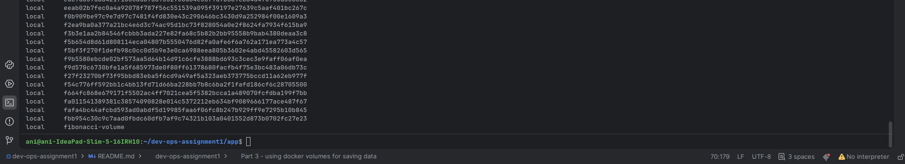
2. Run container with mounted volume
   To run this container with mounted volume we need the following docker command:
    > docker run -it --name fibonacci-container-1 -v fibonacci-volume:/data alpine sh
    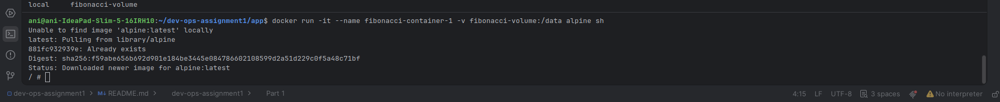
  * Let's test it exists with : cat /data/fibonacci.txt
3. Create and save a file inside a container
   Now that the container is running we execute a file creation with echo inside the container:
   > echo "Fibonacci sequence: 0, 1, 1, 2, 3, 5, 8, 13, 21, 34" > /data/fibonacci.txt
   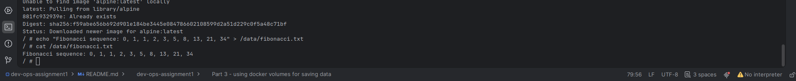
4. Run another container with the same volume and check the file
   Now we run another container but same alpine image and same volume and we verify the file, we don't need the interactive mode anymore, so we run with rm to make sure the second container gets removed and than we check the fibonacci and the file should there since we use the same volume
    > docker run --rm -v fibonacci-volume:/data alpine cat /data/fibonacci.txt
   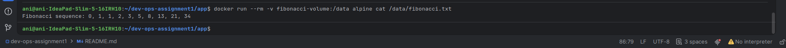